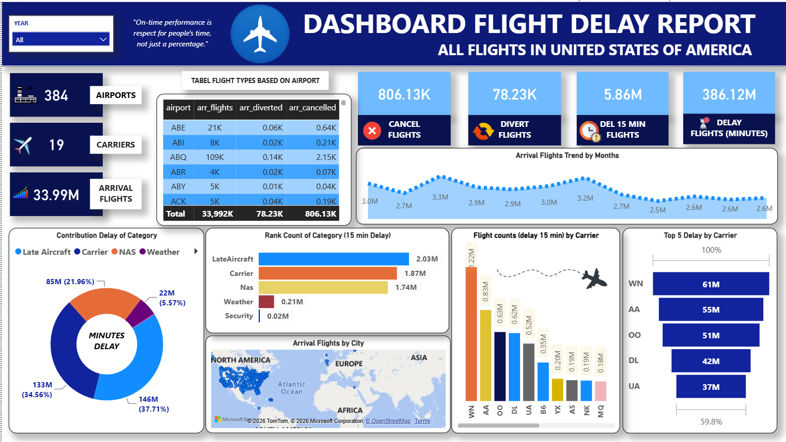

# ✈️ US Flight Delay & Operations Analytics Dashboard

## 📌 Project Overview
This project presents an interactive **Flight Delay Analytics Dashboard** built using **Power BI**. It analyzes commercial flight operations across the United States, focusing on flight cancellations, diversions, delays (>= 15 minutes), and the root causes behind total delay durations.

The goal is to provide actionable data insights for aviation operations, logistics managers, and airline stakeholders to identify operational bottlenecks and improve on-time performance.

---

## 📸 Dashboard Preview


----

## 📊 Key Metrics & Highlights (Summary)
* **Coverage**: **384 Airports** | **19 Carriers** | **33.99M Total Arrival Flights**
* **Disruptions Breakdown**:
  * **Canceled Flights**: 806.13K
  * **Diverted Flights**: 78.23K
  * **Delayed Flights (>=15 mins)**: 5.86M
  * **Total Delay Duration**: **386.12M Minutes**

---

## 🔍 Analytical Insights

### 1. Contribution Delay by Category (Minutes)
* **Late Aircraft**: Accounts for the highest total delay time (**146M mins / 37.71%**).
* **Carrier Delays**: Directly attributed to airline operational management (**133M mins / 34.56%**).
* **NAS (National Airspace System)**: Systemic and traffic control delays (**85M mins / 21.96%**).
* **Weather & Security**: Account for the remaining delay share (**22M mins / 5.57%** and minimal security impacts).

### 2. Delay Frequency by Category (>=15 Mins Count)
* **Late Aircraft** leads with **2.03M instances**, closely followed by **Carrier** (**1.87M**) and **NAS** (**1.74M**).

### 3. Airline Carrier Performance (Top Delays)
* **Southwest Airlines (WN)** recorded the highest number of 15-min delays (**1.22M flights**) and total delay duration (**61M minutes**).
* Followed by major carriers: **American Airlines (AA)** (**55M mins**), **SkyWest (OO)** (**51M mins**), **Delta (DL)** (**42M mins**), and **United Airlines (UA)** (**37M mins**). Together, these top 5 carriers represent nearly **60%** of overall delay minutes.

---

## 🛠️ Tools & Technologies Used
* **Power BI Desktop**: Data modeling, DAX measure creations, and interactive visual report design.
* **Power Query**: Data extraction, transformation, cleaning, and table relationships.
* **Dataset**: U.S. Airline Flight Operations and Delay Data.

---

## 📁 Repository Structure
```text
├── assets/     # Images & screenshots for documentation (Dashboard_preview.png)
├── data/       # Raw/cleaned CSV/Excel datasets
├── pbix/       # Power BI report file (.pbix)
├── .gitignore  # Git ignore file
└── README.md   # Project documentation
